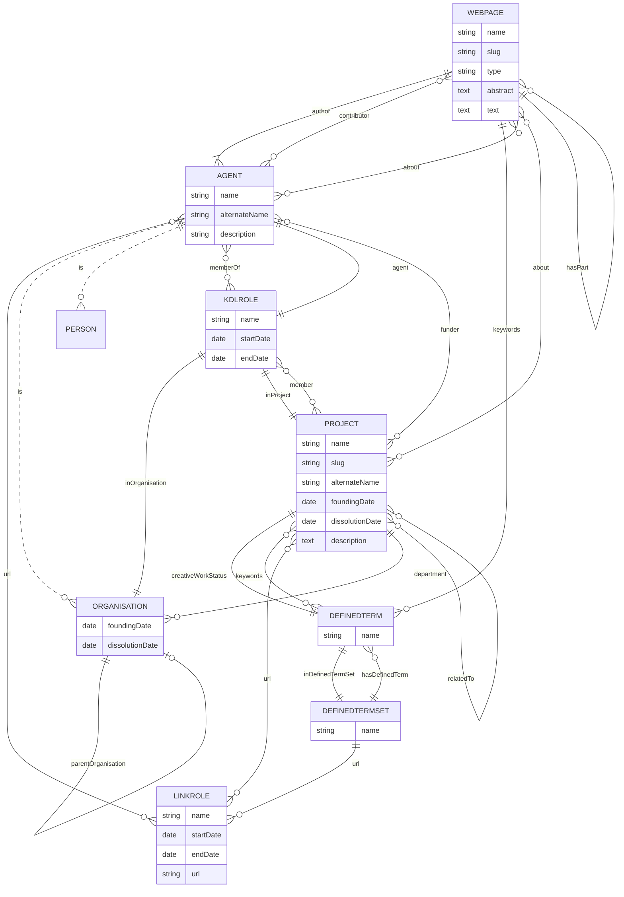

# Contributing

## Content updates

All content updates are to be done directly in the content branch without creating new branches. Files to be located are located in the /docs folder. This is an overview of the folder structure.

```bash
docs
├── about
│   ├── organisations # Autogenerated via the ETL pipeline, do not manually create an organisation.
│   └── people # Autogenerated via the ETL pipeline, you can also manually add a person if required.
├── assets
│   ├── images
│   │   ├── blog # Place here images for blogposts.
│   │   ├── people # Place here images for people.
│   │   ├── projects # Place here images for projects.
│   │   ├── slides # Place here images for slides.
│   │   ├── general # Place here images that are to be used in landing page or otherwise don't depend on specific content.
│   └── videos
├── blog # Location for blogposts markdown files.
├── contact us # Location for contact us page markdown files.
├── faqs # Location for FAQs page markdown files.
├── projects # Autogenerated via the ETL pipeline. You can edit the content of projects but do not edit the metadata, as any changes will be overwritten by the ETL pipeline. Do not manually create projects.
├── slides # Location for slides markdown files.
```

> [!NOTE]

> Do not edit/update files outside of this folder in the content branch, as any changes will get overwritten. If you need any changes outside the /docs folder please let an RSE know.

### Editing via web editor

1.- Switch to branch content: At the top of this page, under the repository name, you can find the current branch name. Click on that button and search for content. Then click on content to switch to that branch.
2.- Click at the top of this page on the green button where it says Code
3.- On the pop up menu click on 'Codespaces'
4.- Click on Create codespace on content.
5.- Proceed with the [editing via text editor instructions.](#with-frontmatter)

> [!NOTE]
> Don't edit any content related files in other branches other than content as these changes might get overwritten.

### Editing via text editor

#### With frontmatter

You'll need a text editor such as [VSCodium](https://vscodium.com/) with the [Frontmatter](https://frontmatter.codes/) extension.

Click on the left where it says FM. The frontmatter extension will open.

##### Add content

> [!NOTE]
> Projects are not to be manually created, they're created by the pipeline with the data from ClickUp

Click on the button located at the right of the view where it says 'Create content'. Select the content type you want to create. You'll need to provide a title.

This will open a new markdown file with the title in the metadata. To edit content start writing your markdown text bellow the 3 dashes at the bottom.

##### Edit content

> [!NOTE]
> Projects' metadata is not to be manually edited, if you need to change any metadata information update the project in ClickUp and trigger the update projects Github Action.

On the Frontmatter plugin view, you can see on the left a sidebar with the most recently modified organisations, people, projects and blog. Select the file you want to edit. If you can't see the file you want to edit, search the content on the top right search bar.

#### Advanced mode

You can use any text editor you'd like to edit the content of markdown files. Look at the structure of an existing file and you can start work from it. Projects are autogenerated so don't manually create them nor edit their metadata.

### Editing notes

- If you create a file manually, make sure that you've added the .md extension at the end of the file.
- If there are any content conflicts due to 2 or more people simultaneously editing the same content, reach out to the person that has made changes to agree on what changes to keep. If you require further assistance please ask an RSE.

## Dev

### Merge strategy


### Data model

The data model is based on the [schema.org](https://schema.org/) vocabulary. Local customisations are prefixed with `KDL`.


